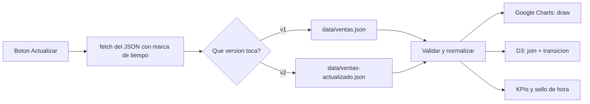
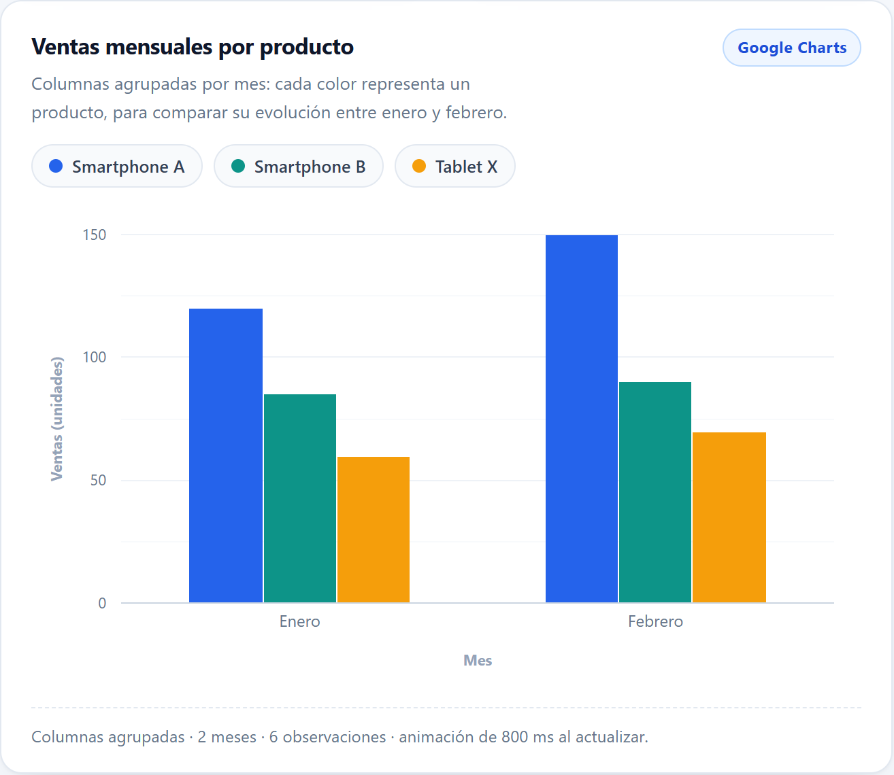
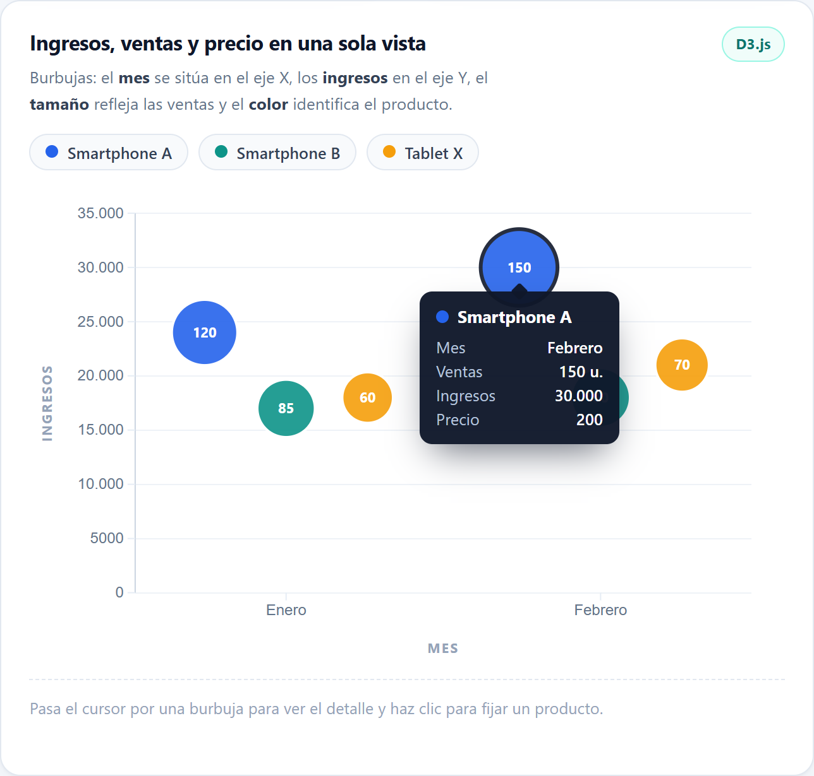
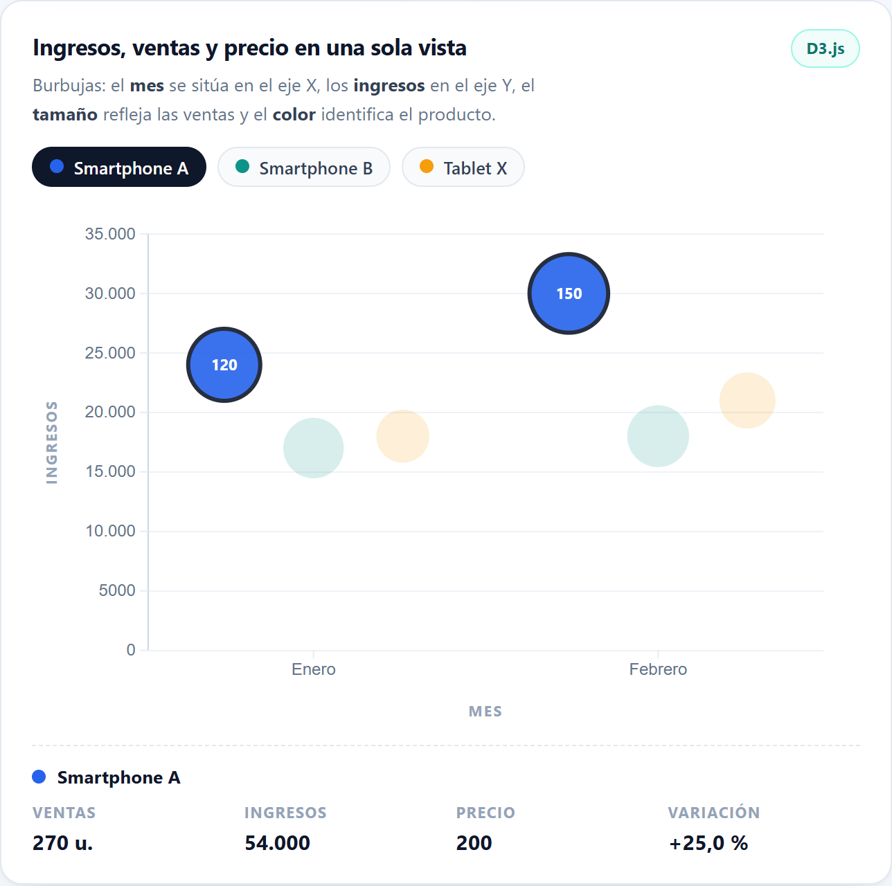
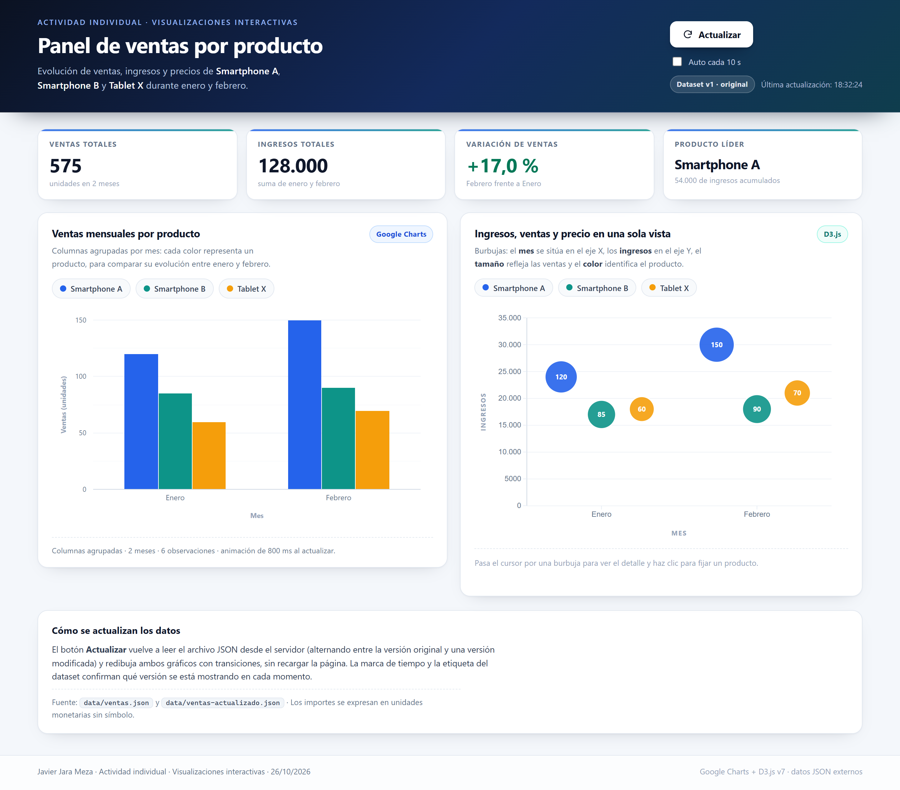
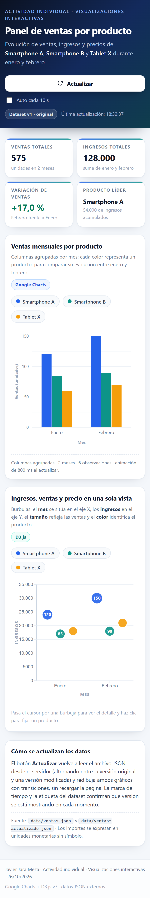
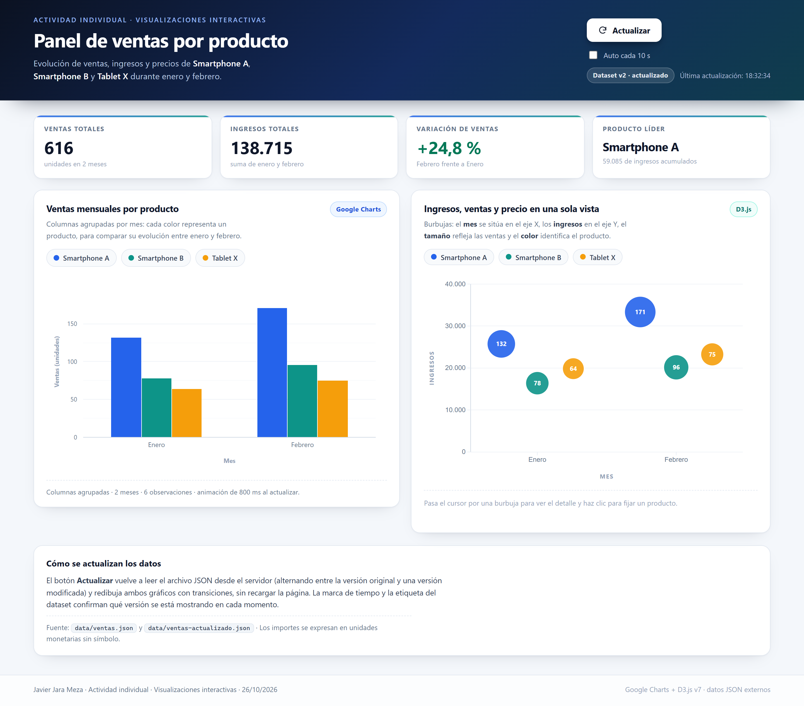

# Visualizaciones interactivas con datos JSON y D3.js

**Alumno:** Javier Jara Meza
**Matrícula:** mexvidama08
**Asignatura:** Visualizaciones interactivas
**Fecha de entrega:** 26/10/2026

---

## 1. Introducción y objetivos

Una empresa de tecnología quiere saber cómo se están comportando sus tres productos
(Smartphone A, Smartphone B y Tablet X) para ajustar su estrategia comercial. Para eso
necesita ver de un vistazo la evolución de las ventas, los ingresos y los precios durante
enero y febrero, y poder consultar el detalle de cada producto sin perderse en tablas.

La actividad pedía construir un dashboard que cubriera cuatro cosas: leer los datos desde
un JSON externo y permitir su actualización, mostrar un gráfico de columnas con Google
Charts, añadir una visualización multidimensional con D3.js y reunir todo en una interfaz
adaptable. El resultado está publicado en
<https://javijarameza.github.io/javier_jara_meza-visualizacion_interactiva/> y el código
completo está en <https://github.com/javijarameza/javier_jara_meza-visualizacion_interactiva>.

El objetivo de esta memoria no es explicar el código línea a línea, sino justificar las
decisiones de diseño y, sobre todo, interpretar lo que dicen los datos.

## 2. Los datos y su preparación

El conjunto de datos son seis observaciones: tres productos por dos meses. Cada registro
tiene cinco campos (producto, mes, ventas, ingresos y precio). Antes de dibujar nada
comprobé una cosa que conviene dejar escrita: los ingresos son exactamente
ventas × precio en los seis casos (por ejemplo, 120 × 200 = 24.000 para el Smartphone A
en enero). Esto significa que los ingresos no aportan información nueva sobre el
comportamiento del mercado, solo sobre el tamaño económico de cada operación, y que
cualquier variación de ingresos entre enero y febrero se explica únicamente por el
volumen, porque los precios no cambian.

Los totales del periodo son 575 unidades y 128.000 unidades monetarias de ingresos:

| Producto | Ventas enero | Ventas febrero | Ingresos enero | Ingresos febrero | Precio |
|---|---:|---:|---:|---:|---:|
| Smartphone A | 120 | 150 | 24.000 | 30.000 | 200 |
| Smartphone B | 85 | 90 | 17.000 | 18.000 | 200 |
| Tablet X | 60 | 70 | 18.000 | 21.000 | 300 |
| **Total** | **265** | **310** | **59.000** | **69.000** | — |

El archivo se guarda en `data/ventas.json` y se sirve desde un servidor Node local. Para
la simulación de actualización preparé una segunda versión,
`data/ventas-actualizado.json`, con cambios en ventas, ingresos y precio que mantienen la
coherencia interna (por ejemplo, el Smartphone A pasa a 132 unidades a 195). Así el botón
"Actualizar" tiene algo distinto que mostrar y el efecto se aprecia de verdad.

## 3. Arquitectura y lógica de actualización

La aplicación es estática: HTML, CSS y JavaScript, sin framework y sin dependencias de
servidor más allá de un pequeño `server.js` que sirve los archivos. D3 se sirve desde el
propio repositorio (carpeta `vendor`) y Google Charts se carga desde su CDN, que es la
única pieza que necesita conexión a internet.

El flujo de actualización es siempre el mismo y no guarda estado en el cliente: cada vez
que se pulsa el botón se vuelve a pedir el JSON al servidor y se reconstruyen las dos
visualizaciones desde cero.

Hay tres detalles que hacen que la actualización funcione como se espera. El primero es
que la petición lleva un parámetro con la hora (`?t=...`) y el servidor responde con
`Cache-Control: no-store`; sin eso el navegador podría devolver la copia que ya tiene
guardada y el usuario vería el mismo gráfico aunque los datos hubieran cambiado. El
segundo es que las dos visualizaciones se alimentan del mismo array ya normalizado, de
modo que no pueden mostrar cifras distintas. El tercero es que el botón se deshabilita
mientras la petición está en curso y la marca de tiempo confirma cuándo se actualizó, para
que no haya dudas de si el clic hizo algo.

Además del botón hay una casilla de actualización automática cada diez segundos, que usa
la misma función. Si la petición falla, aparece un aviso en la parte superior y se
mantiene la última versión válida en pantalla, en lugar de dejar los gráficos vacíos.

## 4. Visualización básica con Google Charts

El primer gráfico es un gráfico de columnas agrupadas. Los meses van en el eje X y las
ventas en el eje Y, con una columna por producto en cada mes y un color fijo para cada
uno. Para construirlo transformo el JSON plano en una tabla con una fila por mes y una
columna por producto, porque es la forma en la que Google Charts entiende las series.

Las decisiones de diseño fueron pocas y deliberadas: colores distintos y bien separados
para que las series se reconozcan sin depender de la leyenda, rejilla horizontal suave
para comparar alturas sin ruido, el eje Y empezando en cero (obligatorio en un gráfico de
columnas, si no las diferencias se exageran) y la leyenda debajo, fuera del área de
dibujo, para que no tape las barras.

La actualización se resolvió volviendo a llamar al método de dibujo con una tabla nueva.
Google Charts interpola solo la transición de alturas, con una animación de 800 ms, así
que el cambio se percibe como un movimiento y no como un salto. El único punto delicado
es el tamaño: la librería necesita píxeles, no porcentajes, por lo que el ancho se lee del
contenedor en cada dibujo y se vuelve a dibujar cuando cambia la ventana.

## 5. Visualización multidimensional con D3.js

El segundo gráfico es el que aporta la lectura multidimensional. Es un gráfico de
burbujas donde cada burbuja es una observación (producto en un mes) y cada canal visual
representa una variable distinta:

- **Eje X:** el mes.
- **Eje Y:** los ingresos.
- **Radio:** las ventas, con una escala de raíz cuadrada para que el área sea proporcional
  al valor y no al cuadrado de este.
- **Color:** el producto.
- **Tooltip:** el precio y el resto de cifras.

Dentro de cada mes las tres burbujas se desplazan ligeramente para que no se tapen, y el
radio máximo se limita en función de esa separación, de manera que el gráfico sigue siendo
legible en un móvil sin que las burbujas se solapen.

Las transiciones se aplican a la posición, al radio y al color: al llegar datos nuevos las
burbujas se mueven a su nueva posición en lugar de reaparecer, y las que sobran se
desvanecen. La interacción tiene tres niveles. Al pasar el ratón por encima, la burbuja
crece un poco y aparece un tooltip con producto, mes, ventas, ingresos y precio, que se
coloca encima o debajo del puntero según el espacio disponible. Al hacer clic, el producto
queda seleccionado: el resto se atenúa y abajo aparece un resumen con sus totales y su
variación. La leyenda de la parte superior hace lo mismo, así que se puede aislar un
producto sin tocar el gráfico.

## 6. Integración y adaptabilidad

Las dos visualizaciones conviven en una sola página con una cabecera común, cuatro
indicadores arriba y los dos paneles debajo. El botón "Actualizar" es único y redibuja
ambos gráficos a la vez, que era el requisito de integración: no hay dos controles que
puedan desincronizarse.

La adaptación se resolvió con una rejilla de CSS que pasa de dos columnas a una cuando el
ancho baja de 1080 px, con tipografía y espacios que se ajustan con `clamp()` y con un
diseño específico para móvil: los indicadores pasan a dos columnas, el botón ocupa todo el
ancho y los gráficos reducen sus márgenes. Los dos gráficos se redibujan al cambiar el
tamaño, no solo se escalan, porque en el gráfico de burbujas el tamaño de los elementos
tiene significado y no conviene deformarlo.

## 7. Resultados e interpretación

Con los datos originales, el periodo cierra con 575 unidades vendidas y 128.000 de
ingresos. Febrero mejora a enero en un 16,98 % en ventas y un 16,95 % en ingresos, es
decir, la empresa crece a doble dígito en solo un mes.

**El crecimiento está concentrado en un producto.** De las 45 unidades adicionales, 30
las aporta el Smartphone A (dos tercios del incremento), 10 la Tablet X y solo 5 el
Smartphone B. El Smartphone A crece un 25 %, la Tablet X un 16,7 % y el Smartphone B un
5,9 %. La diferencia entre el primero y el último no es un detalle de matiz: uno avanza a
un ritmo cuatro veces mayor que el otro.

**El producto que más vende no es el que más ingresos genera por unidad.** El Smartphone A
lidera en unidades (150 en febrero) y en ingresos (30.000), pero la Tablet X, con solo 70
unidades, aporta 21.000 porque su precio es un 50 % más alto. La cuota de ingresos de
febrero queda así: Smartphone A 43,5 %, Tablet X 30,4 % y Smartphone B 26,1 %. La Tablet
es, por tanto, el producto con mayor rentabilidad por operación y el que menos depende del
volumen.

**El Smartphone B es el punto débil.** Crece solo un 5,9 %, pierde cuota de ingresos
respecto a enero (del 28,8 % al 26,1 %) y comparte precio con el Smartphone A, que hace
mejor su trabajo en el mismo segmento. Si la empresa tiene que decidir dónde invertir en
promoción, los datos no justifican poner el esfuerzo en el B.

**El ticket medio no se mueve.** Al ser los precios constantes, el ingreso medio por
unidad se mantiene en 222,6 en los dos meses. Esto confirma que la mejora no viene de
haber vendido más caro, sino de haber vendido más cantidad: el crecimiento es real en
volumen y no un efecto de precio.

**No hay anomalías.** Ningún producto cae y las proporciones entre ellos se mantienen
razonablemente estables, así que lo que se observa es una tendencia de crecimiento, no un
dato atípico que haya que investigar.

### El efecto de la actualización

Al pulsar "Actualizar" se carga la segunda versión del JSON y el panel entero cambia: los
KPIs, las columnas y las burbujas. En esa versión los totales pasan a 616 unidades y
138.715 de ingresos, y la variación de ventas sube al 24,8 %. Lo interesante no es el
número, sino que el orden de los productos no cambia (el Smartphone A sigue liderando),
lo que da confianza en que la conclusión anterior no depende de una versión concreta de
los datos.

## 8. Limitaciones y posibles mejoras

La principal limitación es el tamaño de la muestra: seis observaciones y dos meses
permiten describir una tendencia, pero no proyectarla. Con más meses se podría añadir una
línea de tendencia o una comparación interanual, y con más productos tendría sentido un
filtro por rango de precio.

La segunda es que los precios son fijos. En un caso real habría promociones y cambios de
precio, y entonces sí convendría separar el efecto volumen del efecto precio; hoy esa
separación no aporta nada porque el segundo factor es cero.

La tercera es la dependencia de internet para Google Charts: D3 ya está guardado en el
repositorio, pero el gráfico de columnas necesita descargar su librería. Si esa descarga
falla, el panel avisa y el gráfico de burbujas sigue funcionando, pero la comparación
mensual se pierde. Guardar también Google Charts en local requeriría descargar todo el
paquete del renderizador, que es bastante más pesado que D3. También sería razonable
sustituir la alternancia entre dos archivos por una pequeña API que genere variaciones,
más cerca de un escenario real, aunque para el objetivo de la actividad la solución
actual es más simple de explicar y de revisar.

## 9. Conclusiones

El dashboard cumple los cuatro objetivos: lee los datos de un JSON externo y los actualiza
sin recargar la página, muestra la evolución mensual en un gráfico de columnas, ofrece una
lectura multidimensional en un gráfico de burbujas con transiciones y eventos, y reúne
todo en una interfaz que funciona igual en escritorio y en móvil.

En cuanto a los datos, la conclusión para la empresa es clara: el Smartphone A tira del
crecimiento y concentra la mayor parte de los ingresos, la Tablet X es el producto más
rentable por unidad y el Smartphone B se está quedando atrás en el mismo segmento de
precio que el A. La recomendación sería reforzar la promoción del A, mantener la Tablet
como producto de margen y revisar la propuesta de valor del B antes de seguir invirtiendo
en él.

## 10. Referencias

- D3.js. *Data-Driven Documents*. <https://d3js.org>
- Google. *Google Charts Documentation*. <https://developers.google.com/chart>
- Mozilla. *Fetch API*. <https://developer.mozilla.org/es/docs/Web/API/Fetch_API>
- Node.js. *HTTP module*. <https://nodejs.org/api/http.html>

**Enlaces del proyecto**

- Repositorio: <https://github.com/javijarameza/javier_jara_meza-visualizacion_interactiva>
- Dashboard publicado: <https://javijarameza.github.io/javier_jara_meza-visualizacion_interactiva/>
